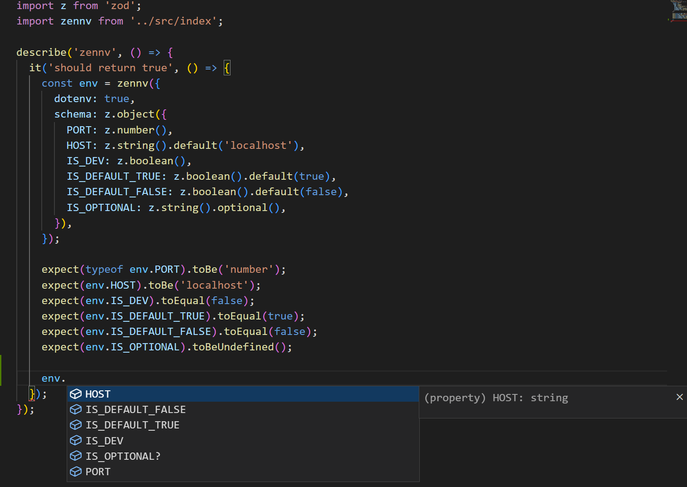

# zennv
Parses environment variables using a Zod schema for type and runtime validation




## Getting started
### Install the package
`zod` (v4 or later) is a peer dependency, so install it alongside `zennv`.

```bash
yarn add zennv zod
```

```bash
pnpm add zennv zod
```

```bash
npm i zennv zod
```

### Define a Zod schema
```ts
import z from 'zod';

const envSchema = z.object({
  PORT: z.number(),
  HOST: z.string().default('localhost'),
  IS_DEV: z.boolean(),
  IS_DEFAULT_TRUE: z.boolean().default(true),
  IS_DEFAULT_FALSE: z.boolean().default(false),
  IS_OPTIONAL: z.string().optional(),
})
```

### Pass the schema to `zennv`
```ts
import zennv from 'zennv';

const env = zennv({
  dotenv: true,
  schema: envSchema,
});
```

### Use the environment variables
```ts
const { PORT, HOST, IS_DEV, IS_DEFAULT_TRUE, IS_DEFAULT_FALSE, IS_OPTIONAL } = env;
```

## Options
| Name   | Default     | Description                                         | Required |
|--------|-------------|-----------------------------------------------------|----------|
| dotenv | true        | Uses dotenv to load your schema from process.env    | No       |
| schema |             | Zod schema to parse your environment variables with | Yes      |
| data   | process.env | An object to use instead of process.env             | No       |
## Releasing
Releases are published to npm by GitHub Actions whenever a `v*` tag is pushed. The tag must match the version in `package.json`. The workflow authenticates with an npm granular access token stored in the `NPM_TOKEN` repository secret.

```bash
npm version <major|minor|patch>
git push --follow-tags
```
